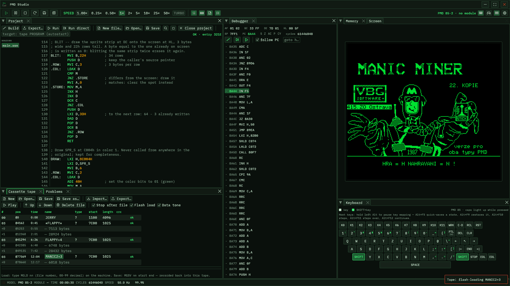

# PMD Studio

An emulator and assembler IDE for the **Tesla PMD 85** family of 8-bit
Czechoslovak home computers (PMD 85-1, 85-2, 85-2A, 85-3), written
in Rust.



The CPU core is a cycle-counted Intel 8080 validated against the
classic CP/M diagnostic ROMs (`8080PRE`, `TST8080`, `CPUTEST`,
`8080EXM`). The machine side follows MAME's `pmd85.cpp` driver:
the memory maps including the boot-time startup shadow map, the
keyboard matrix through the system 8255, the whole speaker circuit,
PMD 85-3 ROM/VRAM banking — plus a cassette deck wired to the 8251
with flash-loading.

On top of the machine sits a small assembler IDE: a project system
with a syntax-highlighting editor driven by the bundled
assembler's own lexer, authentic tape loading (the monitor's `MGLD`
command is typed for you, checksums and autorun run for real), a
direct RAM-inject run mode, and ROM-module targets.

## Highlights

- **Four models** — 85-1, 85-2, 85-2A, 85-3 — each booting its real
  monitor ROM to a working command line
- **Screen the way you like it** — 85-3 RGB colors, a monochrome
  profile with any phosphor color, the ColorAce mod's 7 colors, an
  optional CRT effect (scanlines, glow, vignette), and fullscreen
  (Alt+Enter)
- **Authentic tape** — `.ptp` cassette images, a full tape editor,
  real modulated playback *or* flash-loading, saves (`MGSV`)
  harvested back into the tape, the archive's example tapes one
  click away in the Tape window
- **Assembler IDE** — projects, find/replace, go-to, problems panel
  with jump-to-error, build + export to tape / ROM module / raw
  binary, [a lenient monitor-style dialect](docs/asm-dialect.md)
  with macros and local labels
- **Debugger** — live registers, monitor-style disassembly with
  breakpoints and follow-PC, a 64 KiB hex+ASCII memory dump
- **Joysticks** — the 4004/482 stick on both I/O connectors, driven
  by a gamepad
- **Speaker** — the whole sound circuit (software square wave plus
  the gated 1 kHz / 4 kHz video-divider tones)
- **Desktop app** — docking UI with layout persistence, themes with
  a color customizer, custom titlebar, save states, 0.25x–50x
  speed and turbo

## Quick start

```
cargo run -p pmd85-app --release
```

Then type `DUMP 0100` on the monitor command line, or create a
project in the Project tab and press **Run**.

CLI options: `--model <85-1|85-2|85-2A|85-3>`, `--monitor <path>`,
`--rom-module <path>`, `--rom-dir <dir>`, `--tapes-dir <dir>`,
`--mute`. The host keyboard is the emulated one (F1–F12 are the
PMD's K0–K11, `Esc` and `Ctrl` are STOP); hold Left `Alt` for host
shortcuts (quick-save/load state, debugger stepping). See
[the emulator docs](docs/emulator.md) for the full keyboard mapping
and everything else.

Monitor ROMs live in `Rom/` (see `Rom/rom-list.txt`) and are not
part of this repository's source; the boot tests require them to be
present.

### Portable builds

Any of the resource directories can be embedded into the binary
instead of read from disk:

```
cargo build --release -p pmd85-app --features portable
```

- `embed-roms` — the monitor ROMs and ROM modules from `Rom/` ship
  inside the binary; an installed copy runs anywhere without the
  files next to it (about +0.6 MB)
- `embed-tapes` — the example tapes from `Tapes/` ship inside the
  binary and appear as the Tape window's bundled library
  (about +1.0 MB)
- `portable` — both of the above (+1.6 MB in total)

`--rom-dir`/`--tapes-dir` still override the embedding and scan a
directory; `--tapes-dir` also adds the bundled-tape library to a
build without `embed-tapes`.

## Documentation

- [The emulator](docs/emulator.md) — models and machine internals,
  the interface, debugger, tape, save states, keyboard, joysticks
- [The assembler IDE](docs/ide.md) — projects, the editor, run
  (authentic and direct), the ROM-module target, export
- [The assembler dialect](docs/asm-dialect.md) — the full language
  reference with examples
- [Desktop integration](docs/desktop.md) — taskbar icon and the
  desktop entry

## Crates

| Crate | Contents |
|---|---|
| `crates/pmd85-core` | Pure emulation logic: i8080 CPU, memory maps, 8255/8253/8251 chips, keyboard matrix, VRAM decode, cassette tape images and deck, disassembler, save states, machine glue. No dependencies. |
| `crates/pmd85-asm` | PMD 85 assembler: lenient monitor-style dialect, two passes, segments and symbol table, spanned diagnostics, round-trips the bundled ROM images bit-exactly. No dependencies. |
| `crates/pmd85-app` | Desktop application: winit window + wgpu blit of the 288x256 framebuffer, egui UI with dockable panels, 50 Hz real-time pacing, debugger, tape editor, assembler IDE, speaker audio. |

## Testing

```
cargo test --workspace
```

- `pmd85-core` unit tests: every instruction group, memory maps,
  chips, keyboard, VRAM decode, speaker, disassembler golden
  tables, tape image parse/build, save-state round-trips
- the CP/M diagnostic ROMs run headless through the machine;
  every model boots its monitor to a working command line; the
  monitor BIOS detects and runs ROM modules
- `pmd85-app`: headless egui frame-building tests in every UI
  state, the IDE's run flows end-to-end against the real monitor
  ROMs, settings/session/layout round-trips, editor regression
  tests (jump targeting, find behavior, editor-scoped shortcuts)

## Status

Done: CPU, memory, keyboard, video, boot of all four models,
monitor command execution, ROM module support (monitor BIOS
detects/transfers/runs BASIC modules), wgpu display, speaker audio,
docking UI with layout persistence, themes, save states,
speed control/turbo, cassette tape images with a full editor,
playback and flash-loading, debugger (registers, disassembly,
breakpoints, step/step-over/continue), memory dump, custom
titlebar, desktop integration, assembler IDE (projects,
highlighting editor, problems panel, authentic and direct run).

Not yet: serial I/O beyond the cassette path (the 8251 serves the
deck), disk image support.

## License

The code in this repository is licensed under the [MIT license](LICENSE).

The monitor ROM dumps in `Rom/` and the bundled tape images in `Tapes/` are third-party material and are not covered by
that license.

## References

- [pmd85.borik.net wiki](https://pmd85.borik.net/wiki/) — hardware
  docs
- MAME `tesla/pmd85.cpp` driver (memory maps, I/O decoding)
- superzazu/8080 `i8080.c` (undocumented flag semantics)
